<a href="https://aim-qu.github.io/aim-qu/#rain">
<picture>
  <source media="(prefers-reduced-motion: reduce)" srcset="./assets/rain-still.png">
  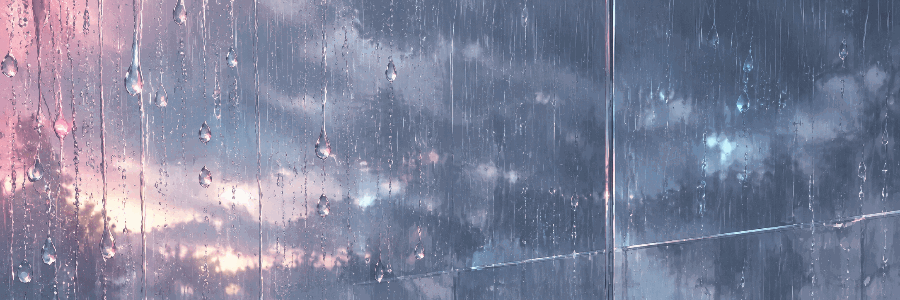
</picture>
</a>

<a href="https://aim-qu.github.io/aim-qu/"><strong>OPEN PLAYGROUND / ひらく</strong></a>

このページでは、各場面の動きと操作例を紹介しています。画像を押すと、実際に遊べる画面が開きます。

## RAIN WINDOW / 雨窓

<a href="https://aim-qu.github.io/aim-qu/#rain">
<picture>
  <source media="(prefers-reduced-motion: reduce)" srcset="./assets/showcase-rain.png">
  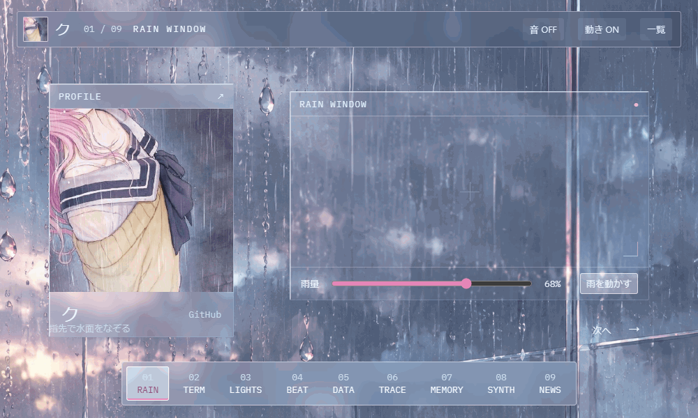
</picture>
</a>

雨量を変える。流れを止める。音を聴く。

[雨窓をひらく](https://aim-qu.github.io/aim-qu/#rain)

## TERMINAL / カラーコマンド

<a href="https://aim-qu.github.io/aim-qu/#terminal">
<picture>
  <source media="(prefers-reduced-motion: reduce)" srcset="./assets/showcase-terminal.png">
  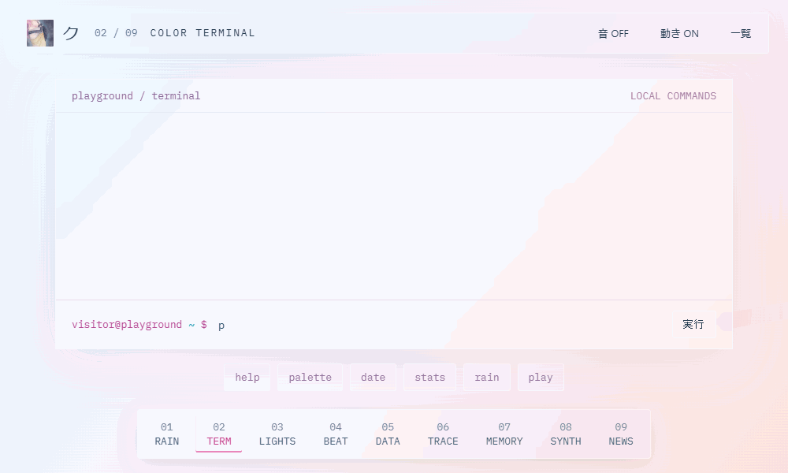
</picture>
</a>

色の一覧、時刻、公開プロフィール。コマンドで場面を移動。

[コマンドを試す](https://aim-qu.github.io/aim-qu/#terminal)

## LIGHTS OUT / ライトパズル

<a href="https://aim-qu.github.io/aim-qu/#lights">
<picture>
  <source media="(prefers-reduced-motion: reduce)" srcset="./assets/showcase-lights.png">
  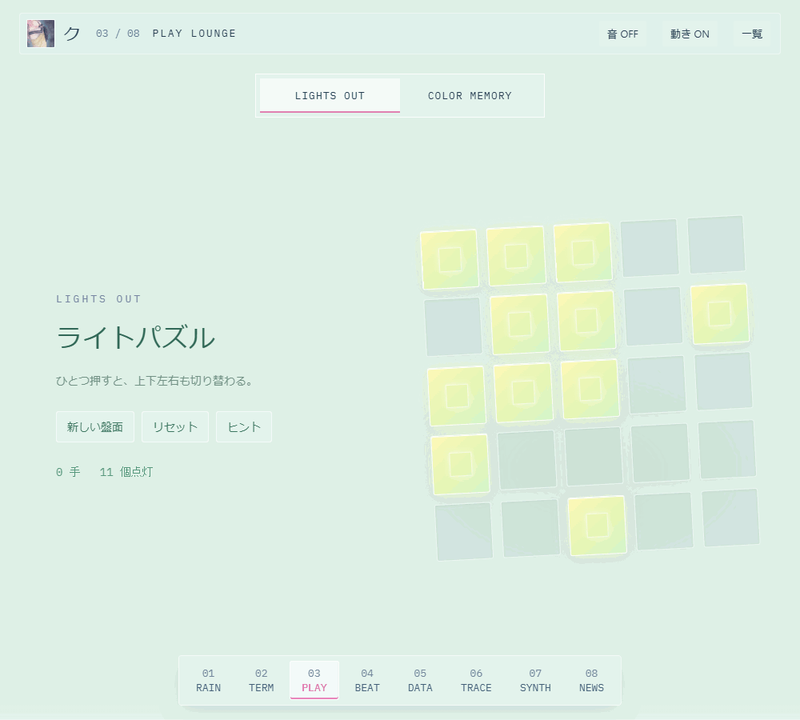
</picture>
</a>

ひとつ押すと、上下左右も切り替わる。すべて消したらクリア。ゲーム区のタブからカラーメモリーにも切り替えられます。

[パズルで遊ぶ](https://aim-qu.github.io/aim-qu/#lights)

## RAIN BEAT / 雨滴リズム

<a href="https://aim-qu.github.io/aim-qu/#rhythm">
<picture>
  <source media="(prefers-reduced-motion: reduce)" srcset="./assets/showcase-rhythm.png">
  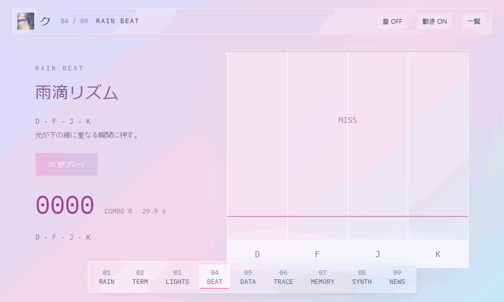
</picture>
</a>

D · F · J · K。光が線に重なる瞬間に押す、30 秒のゲーム。

[リズムゲームで遊ぶ](https://aim-qu.github.io/aim-qu/#rhythm)

## PUBLIC DATA / 公開プロフィール

<a href="https://aim-qu.github.io/aim-qu/#observatory">
<picture>
  <source media="(prefers-reduced-motion: reduce)" srcset="./assets/showcase-observatory.png">
  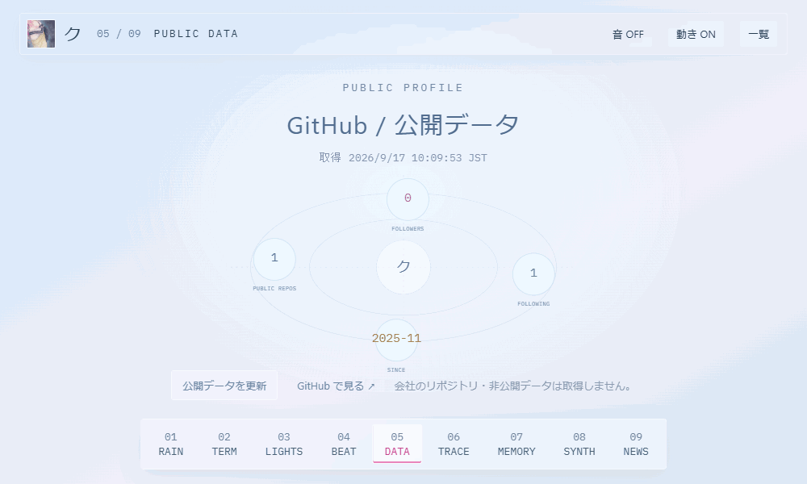
</picture>
</a>

GitHub の公開情報を表示。画面から最新の情報を取得できます。

[公開データを見る](https://aim-qu.github.io/aim-qu/#observatory)

## TRACE / 線と色

<a href="https://aim-qu.github.io/aim-qu/#ink">
<picture>
  <source media="(prefers-reduced-motion: reduce)" srcset="./assets/showcase-ink.png">
  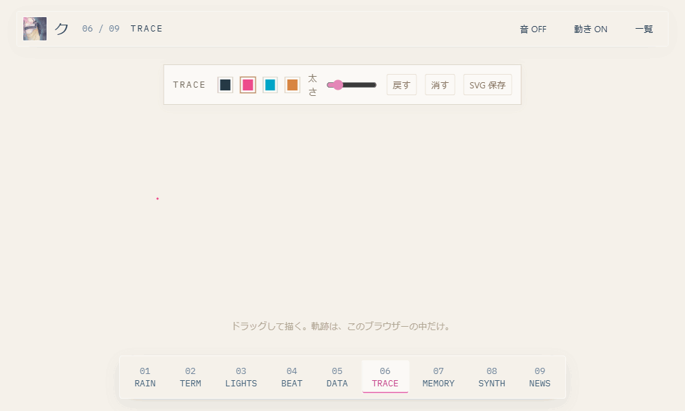
</picture>
</a>

3 色の線も、ひと筆だけでも。戻す・消す・SVG 保存。

[キャンバスに描く](https://aim-qu.github.io/aim-qu/#ink)

## COLOR MEMORY / 色と形

<a href="https://aim-qu.github.io/aim-qu/#memory">
<picture>
  <source media="(prefers-reduced-motion: reduce)" srcset="./assets/showcase-memory.png">
  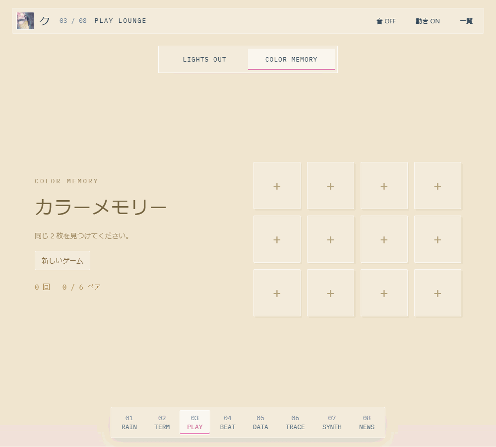
</picture>
</a>

12 枚のカードから、同じ色と形のペアを探す。ライトパズルと同じ場所で切り替え。途中の状態はそのまま。

[カードをめくる](https://aim-qu.github.io/aim-qu/#memory)

## SPECTRUM / 音と波形

<a href="https://aim-qu.github.io/aim-qu/#synth">
<picture>
  <source media="(prefers-reduced-motion: reduce)" srcset="./assets/showcase-synth.png">
  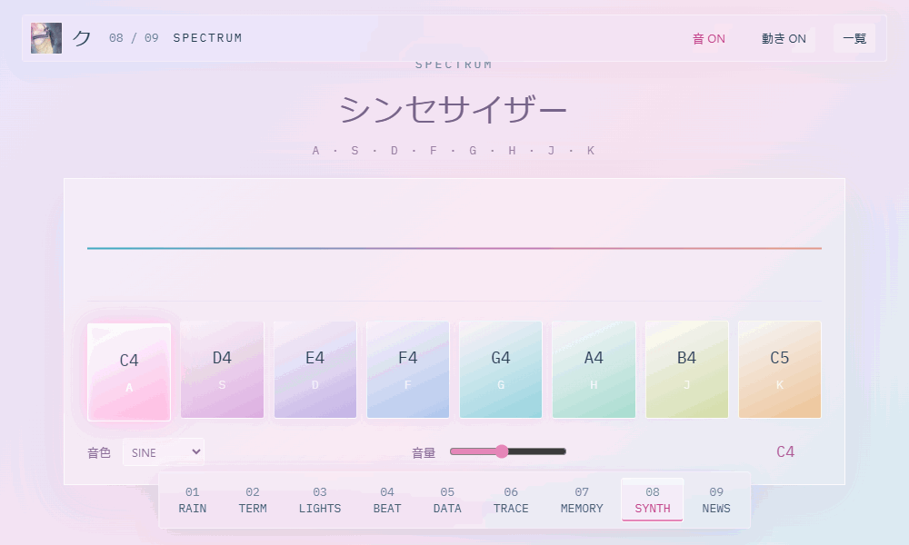
</picture>
</a>

A · S · D · F · G · H · J · K。8 音と 3 種類の波形。

[音を鳴らす](https://aim-qu.github.io/aim-qu/#synth)

## MODEL BRIEFING / AI ニュース

<a href="https://aim-qu.github.io/aim-qu/#news">
<picture>
  <source media="(prefers-reduced-motion: reduce)" srcset="./assets/showcase-news.png">
  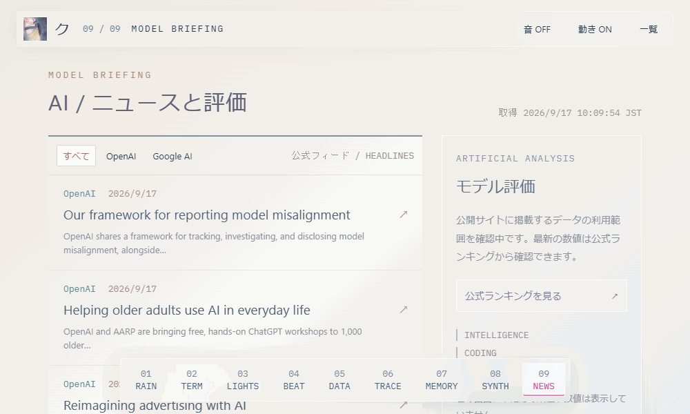
</picture>
</a>

OpenAI と Google AI の公式ニュース。発表元へのリンクを添えて。

[ニュースを読む](https://aim-qu.github.io/aim-qu/#news)

### HEADLINES

2026-09-17 JST 取得。以下は保存時点の見出しです。

- **OpenAI** · 2026-09-17 JST — [Our framework for reporting model misalignment](https://openai.com/index/model-misalignment-reporting-framework)
- **OpenAI** · 2026-09-17 JST — [Helping older adults use AI in everyday life](https://openai.com/index/helping-older-adults-use-ai-in-everyday-life)
- **OpenAI** · 2026-09-16 JST — [Reimagining advertising with AI](https://openai.com/index/reimagining-advertising-with-ai)
- **Google AI** · 2026-09-16 JST — [AI for Societal Impact](https://blog.google/innovation-and-ai/technology/ai/ai-for-societal-impact/)
- **Google AI** · 2026-09-16 JST — [Building AI to accelerate science and improve lives](https://blog.google/innovation-and-ai/technology/ai/ai-applications-science-people/)
- **Google AI** · 2026-09-16 JST — [AI for everyone in every language](https://blog.google/innovation-and-ai/technology/ai/ai-for-every-language/)

## MODEL WATCH / Artificial Analysis

<a href="https://artificialanalysis.ai/#artificial-analysis-intelligence-index">
  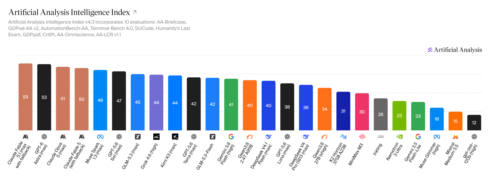
</a>

2026-09-17 10:52 JST 取得 · Intelligence Index v4.3 · 公式の初期表示（26 モデル）

[原寸で見る](./assets/aa-intelligence.png) · [最新の公式チャート](https://artificialanalysis.ai/#artificial-analysis-intelligence-index)

保存時点の画像です。AA の自動取得は設定していません。

<strong>操作 / CONTROLS</strong>

- 各画像から、その場面を直接ひらけます。
- 遊べる画面では、下のメニューか ← → で移動できます。
- Rain Beat：D / F / J / K。Spectrum：A / S / D / F / G / H / J / K。
- 音は操作するまで鳴りません。GIF は無音の操作例です。
- ゲーム記録と描画は、そのブラウザー内だけで扱います。
- 動きを減らす設定では、各 GIF の代わりに静止画を表示します。

<strong>データと素材 / SOURCES</strong>

- プロフィール：[GitHub の公開 API](https://api.github.com/users/aim-qu)。非公開リポジトリは取得しません。
- ニュース：[OpenAI 公式 RSS](https://openai.com/news/rss.xml)と[Google AI 公式 RSS](https://blog.google/technology/ai/rss/)。この README の見出しは上記取得日時の保存内容です。
- モデル評価：Artificial Analysis の公式ダウンロード画像。[引用ガイドライン](https://artificialanalysis.ai/brand-kit)に沿って、図の署名・指数バージョン・モデルの条件を残しています。
- 雨景：既存アバターの色調を参考に生成した背景と、独立した雨滴のシミュレーション。
- 動作デモ：このリポジトリの画面を実際に操作して録画。フォント：IBM Plex Mono / SIL Open Font License。

