<!-- live:sky -->

<!-- /live:sky -->

<!-- live:shoji -->

<!-- /live:shoji -->

<!-- live:go -->

<a href="https://github.com/aim-qu/aim-qu/issues/new?title=%E7%9F%B3%E3%82%92%E8%BF%94%E3%81%99%E3%80%80A1&body=%E3%81%93%E3%81%AE%E3%81%BE%E3%81%BE%E9%80%81%E4%BF%A1%E3%81%99%E3%82%8B%E3%81%A8%E3%80%81A1%E3%81%AE%E7%9F%B3%E3%81%A8%E3%81%9D%E3%81%AE%E4%B8%8A%E4%B8%8B%E5%B7%A6%E5%8F%B3%E3%81%AE%E7%9F%B3%E3%81%8C%E8%BF%94%E3%82%8A%E3%81%BE%E3%81%99%E3%80%82%0A%E4%B8%80%E5%88%86%E3%81%BB%E3%81%A9%E3%81%A7README%E3%81%AE%E7%9B%A4%E3%81%8C%E6%9B%B8%E3%81%8D%E6%8F%9B%E3%82%8F%E3%82%8A%E3%80%81%E3%81%93%E3%81%AEissue%E3%81%AF%E8%87%AA%E5%8B%95%E3%81%A7%E9%96%89%E3%81%98%E3%81%BE%E3%81%99%E3%80%82">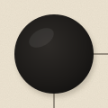</a> <a href="https://github.com/aim-qu/aim-qu/issues/new?title=%E7%9F%B3%E3%82%92%E8%BF%94%E3%81%99%E3%80%80B1&body=%E3%81%93%E3%81%AE%E3%81%BE%E3%81%BE%E9%80%81%E4%BF%A1%E3%81%99%E3%82%8B%E3%81%A8%E3%80%81B1%E3%81%AE%E7%9F%B3%E3%81%A8%E3%81%9D%E3%81%AE%E4%B8%8A%E4%B8%8B%E5%B7%A6%E5%8F%B3%E3%81%AE%E7%9F%B3%E3%81%8C%E8%BF%94%E3%82%8A%E3%81%BE%E3%81%99%E3%80%82%0A%E4%B8%80%E5%88%86%E3%81%BB%E3%81%A9%E3%81%A7README%E3%81%AE%E7%9B%A4%E3%81%8C%E6%9B%B8%E3%81%8D%E6%8F%9B%E3%82%8F%E3%82%8A%E3%80%81%E3%81%93%E3%81%AEissue%E3%81%AF%E8%87%AA%E5%8B%95%E3%81%A7%E9%96%89%E3%81%98%E3%81%BE%E3%81%99%E3%80%82">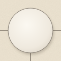</a> <a href="https://github.com/aim-qu/aim-qu/issues/new?title=%E7%9F%B3%E3%82%92%E8%BF%94%E3%81%99%E3%80%80C1&body=%E3%81%93%E3%81%AE%E3%81%BE%E3%81%BE%E9%80%81%E4%BF%A1%E3%81%99%E3%82%8B%E3%81%A8%E3%80%81C1%E3%81%AE%E7%9F%B3%E3%81%A8%E3%81%9D%E3%81%AE%E4%B8%8A%E4%B8%8B%E5%B7%A6%E5%8F%B3%E3%81%AE%E7%9F%B3%E3%81%8C%E8%BF%94%E3%82%8A%E3%81%BE%E3%81%99%E3%80%82%0A%E4%B8%80%E5%88%86%E3%81%BB%E3%81%A9%E3%81%A7README%E3%81%AE%E7%9B%A4%E3%81%8C%E6%9B%B8%E3%81%8D%E6%8F%9B%E3%82%8F%E3%82%8A%E3%80%81%E3%81%93%E3%81%AEissue%E3%81%AF%E8%87%AA%E5%8B%95%E3%81%A7%E9%96%89%E3%81%98%E3%81%BE%E3%81%99%E3%80%82">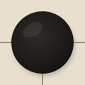</a> <a href="https://github.com/aim-qu/aim-qu/issues/new?title=%E7%9F%B3%E3%82%92%E8%BF%94%E3%81%99%E3%80%80D1&body=%E3%81%93%E3%81%AE%E3%81%BE%E3%81%BE%E9%80%81%E4%BF%A1%E3%81%99%E3%82%8B%E3%81%A8%E3%80%81D1%E3%81%AE%E7%9F%B3%E3%81%A8%E3%81%9D%E3%81%AE%E4%B8%8A%E4%B8%8B%E5%B7%A6%E5%8F%B3%E3%81%AE%E7%9F%B3%E3%81%8C%E8%BF%94%E3%82%8A%E3%81%BE%E3%81%99%E3%80%82%0A%E4%B8%80%E5%88%86%E3%81%BB%E3%81%A9%E3%81%A7README%E3%81%AE%E7%9B%A4%E3%81%8C%E6%9B%B8%E3%81%8D%E6%8F%9B%E3%82%8F%E3%82%8A%E3%80%81%E3%81%93%E3%81%AEissue%E3%81%AF%E8%87%AA%E5%8B%95%E3%81%A7%E9%96%89%E3%81%98%E3%81%BE%E3%81%99%E3%80%82"></a> <a href="https://github.com/aim-qu/aim-qu/issues/new?title=%E7%9F%B3%E3%82%92%E8%BF%94%E3%81%99%E3%80%80E1&body=%E3%81%93%E3%81%AE%E3%81%BE%E3%81%BE%E9%80%81%E4%BF%A1%E3%81%99%E3%82%8B%E3%81%A8%E3%80%81E1%E3%81%AE%E7%9F%B3%E3%81%A8%E3%81%9D%E3%81%AE%E4%B8%8A%E4%B8%8B%E5%B7%A6%E5%8F%B3%E3%81%AE%E7%9F%B3%E3%81%8C%E8%BF%94%E3%82%8A%E3%81%BE%E3%81%99%E3%80%82%0A%E4%B8%80%E5%88%86%E3%81%BB%E3%81%A9%E3%81%A7README%E3%81%AE%E7%9B%A4%E3%81%8C%E6%9B%B8%E3%81%8D%E6%8F%9B%E3%82%8F%E3%82%8A%E3%80%81%E3%81%93%E3%81%AEissue%E3%81%AF%E8%87%AA%E5%8B%95%E3%81%A7%E9%96%89%E3%81%98%E3%81%BE%E3%81%99%E3%80%82"></a> 
<a href="https://github.com/aim-qu/aim-qu/issues/new?title=%E7%9F%B3%E3%82%92%E8%BF%94%E3%81%99%E3%80%80A2&body=%E3%81%93%E3%81%AE%E3%81%BE%E3%81%BE%E9%80%81%E4%BF%A1%E3%81%99%E3%82%8B%E3%81%A8%E3%80%81A2%E3%81%AE%E7%9F%B3%E3%81%A8%E3%81%9D%E3%81%AE%E4%B8%8A%E4%B8%8B%E5%B7%A6%E5%8F%B3%E3%81%AE%E7%9F%B3%E3%81%8C%E8%BF%94%E3%82%8A%E3%81%BE%E3%81%99%E3%80%82%0A%E4%B8%80%E5%88%86%E3%81%BB%E3%81%A9%E3%81%A7README%E3%81%AE%E7%9B%A4%E3%81%8C%E6%9B%B8%E3%81%8D%E6%8F%9B%E3%82%8F%E3%82%8A%E3%80%81%E3%81%93%E3%81%AEissue%E3%81%AF%E8%87%AA%E5%8B%95%E3%81%A7%E9%96%89%E3%81%98%E3%81%BE%E3%81%99%E3%80%82">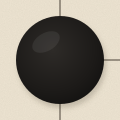</a> <a href="https://github.com/aim-qu/aim-qu/issues/new?title=%E7%9F%B3%E3%82%92%E8%BF%94%E3%81%99%E3%80%80B2&body=%E3%81%93%E3%81%AE%E3%81%BE%E3%81%BE%E9%80%81%E4%BF%A1%E3%81%99%E3%82%8B%E3%81%A8%E3%80%81B2%E3%81%AE%E7%9F%B3%E3%81%A8%E3%81%9D%E3%81%AE%E4%B8%8A%E4%B8%8B%E5%B7%A6%E5%8F%B3%E3%81%AE%E7%9F%B3%E3%81%8C%E8%BF%94%E3%82%8A%E3%81%BE%E3%81%99%E3%80%82%0A%E4%B8%80%E5%88%86%E3%81%BB%E3%81%A9%E3%81%A7README%E3%81%AE%E7%9B%A4%E3%81%8C%E6%9B%B8%E3%81%8D%E6%8F%9B%E3%82%8F%E3%82%8A%E3%80%81%E3%81%93%E3%81%AEissue%E3%81%AF%E8%87%AA%E5%8B%95%E3%81%A7%E9%96%89%E3%81%98%E3%81%BE%E3%81%99%E3%80%82">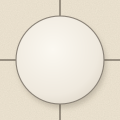</a> <a href="https://github.com/aim-qu/aim-qu/issues/new?title=%E7%9F%B3%E3%82%92%E8%BF%94%E3%81%99%E3%80%80C2&body=%E3%81%93%E3%81%AE%E3%81%BE%E3%81%BE%E9%80%81%E4%BF%A1%E3%81%99%E3%82%8B%E3%81%A8%E3%80%81C2%E3%81%AE%E7%9F%B3%E3%81%A8%E3%81%9D%E3%81%AE%E4%B8%8A%E4%B8%8B%E5%B7%A6%E5%8F%B3%E3%81%AE%E7%9F%B3%E3%81%8C%E8%BF%94%E3%82%8A%E3%81%BE%E3%81%99%E3%80%82%0A%E4%B8%80%E5%88%86%E3%81%BB%E3%81%A9%E3%81%A7README%E3%81%AE%E7%9B%A4%E3%81%8C%E6%9B%B8%E3%81%8D%E6%8F%9B%E3%82%8F%E3%82%8A%E3%80%81%E3%81%93%E3%81%AEissue%E3%81%AF%E8%87%AA%E5%8B%95%E3%81%A7%E9%96%89%E3%81%98%E3%81%BE%E3%81%99%E3%80%82"></a> <a href="https://github.com/aim-qu/aim-qu/issues/new?title=%E7%9F%B3%E3%82%92%E8%BF%94%E3%81%99%E3%80%80D2&body=%E3%81%93%E3%81%AE%E3%81%BE%E3%81%BE%E9%80%81%E4%BF%A1%E3%81%99%E3%82%8B%E3%81%A8%E3%80%81D2%E3%81%AE%E7%9F%B3%E3%81%A8%E3%81%9D%E3%81%AE%E4%B8%8A%E4%B8%8B%E5%B7%A6%E5%8F%B3%E3%81%AE%E7%9F%B3%E3%81%8C%E8%BF%94%E3%82%8A%E3%81%BE%E3%81%99%E3%80%82%0A%E4%B8%80%E5%88%86%E3%81%BB%E3%81%A9%E3%81%A7README%E3%81%AE%E7%9B%A4%E3%81%8C%E6%9B%B8%E3%81%8D%E6%8F%9B%E3%82%8F%E3%82%8A%E3%80%81%E3%81%93%E3%81%AEissue%E3%81%AF%E8%87%AA%E5%8B%95%E3%81%A7%E9%96%89%E3%81%98%E3%81%BE%E3%81%99%E3%80%82"></a> <a href="https://github.com/aim-qu/aim-qu/issues/new?title=%E7%9F%B3%E3%82%92%E8%BF%94%E3%81%99%E3%80%80E2&body=%E3%81%93%E3%81%AE%E3%81%BE%E3%81%BE%E9%80%81%E4%BF%A1%E3%81%99%E3%82%8B%E3%81%A8%E3%80%81E2%E3%81%AE%E7%9F%B3%E3%81%A8%E3%81%9D%E3%81%AE%E4%B8%8A%E4%B8%8B%E5%B7%A6%E5%8F%B3%E3%81%AE%E7%9F%B3%E3%81%8C%E8%BF%94%E3%82%8A%E3%81%BE%E3%81%99%E3%80%82%0A%E4%B8%80%E5%88%86%E3%81%BB%E3%81%A9%E3%81%A7README%E3%81%AE%E7%9B%A4%E3%81%8C%E6%9B%B8%E3%81%8D%E6%8F%9B%E3%82%8F%E3%82%8A%E3%80%81%E3%81%93%E3%81%AEissue%E3%81%AF%E8%87%AA%E5%8B%95%E3%81%A7%E9%96%89%E3%81%98%E3%81%BE%E3%81%99%E3%80%82">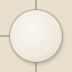</a> 
<a href="https://github.com/aim-qu/aim-qu/issues/new?title=%E7%9F%B3%E3%82%92%E8%BF%94%E3%81%99%E3%80%80A3&body=%E3%81%93%E3%81%AE%E3%81%BE%E3%81%BE%E9%80%81%E4%BF%A1%E3%81%99%E3%82%8B%E3%81%A8%E3%80%81A3%E3%81%AE%E7%9F%B3%E3%81%A8%E3%81%9D%E3%81%AE%E4%B8%8A%E4%B8%8B%E5%B7%A6%E5%8F%B3%E3%81%AE%E7%9F%B3%E3%81%8C%E8%BF%94%E3%82%8A%E3%81%BE%E3%81%99%E3%80%82%0A%E4%B8%80%E5%88%86%E3%81%BB%E3%81%A9%E3%81%A7README%E3%81%AE%E7%9B%A4%E3%81%8C%E6%9B%B8%E3%81%8D%E6%8F%9B%E3%82%8F%E3%82%8A%E3%80%81%E3%81%93%E3%81%AEissue%E3%81%AF%E8%87%AA%E5%8B%95%E3%81%A7%E9%96%89%E3%81%98%E3%81%BE%E3%81%99%E3%80%82"></a> <a href="https://github.com/aim-qu/aim-qu/issues/new?title=%E7%9F%B3%E3%82%92%E8%BF%94%E3%81%99%E3%80%80B3&body=%E3%81%93%E3%81%AE%E3%81%BE%E3%81%BE%E9%80%81%E4%BF%A1%E3%81%99%E3%82%8B%E3%81%A8%E3%80%81B3%E3%81%AE%E7%9F%B3%E3%81%A8%E3%81%9D%E3%81%AE%E4%B8%8A%E4%B8%8B%E5%B7%A6%E5%8F%B3%E3%81%AE%E7%9F%B3%E3%81%8C%E8%BF%94%E3%82%8A%E3%81%BE%E3%81%99%E3%80%82%0A%E4%B8%80%E5%88%86%E3%81%BB%E3%81%A9%E3%81%A7README%E3%81%AE%E7%9B%A4%E3%81%8C%E6%9B%B8%E3%81%8D%E6%8F%9B%E3%82%8F%E3%82%8A%E3%80%81%E3%81%93%E3%81%AEissue%E3%81%AF%E8%87%AA%E5%8B%95%E3%81%A7%E9%96%89%E3%81%98%E3%81%BE%E3%81%99%E3%80%82">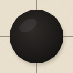</a> <a href="https://github.com/aim-qu/aim-qu/issues/new?title=%E7%9F%B3%E3%82%92%E8%BF%94%E3%81%99%E3%80%80C3&body=%E3%81%93%E3%81%AE%E3%81%BE%E3%81%BE%E9%80%81%E4%BF%A1%E3%81%99%E3%82%8B%E3%81%A8%E3%80%81C3%E3%81%AE%E7%9F%B3%E3%81%A8%E3%81%9D%E3%81%AE%E4%B8%8A%E4%B8%8B%E5%B7%A6%E5%8F%B3%E3%81%AE%E7%9F%B3%E3%81%8C%E8%BF%94%E3%82%8A%E3%81%BE%E3%81%99%E3%80%82%0A%E4%B8%80%E5%88%86%E3%81%BB%E3%81%A9%E3%81%A7README%E3%81%AE%E7%9B%A4%E3%81%8C%E6%9B%B8%E3%81%8D%E6%8F%9B%E3%82%8F%E3%82%8A%E3%80%81%E3%81%93%E3%81%AEissue%E3%81%AF%E8%87%AA%E5%8B%95%E3%81%A7%E9%96%89%E3%81%98%E3%81%BE%E3%81%99%E3%80%82"></a> <a href="https://github.com/aim-qu/aim-qu/issues/new?title=%E7%9F%B3%E3%82%92%E8%BF%94%E3%81%99%E3%80%80D3&body=%E3%81%93%E3%81%AE%E3%81%BE%E3%81%BE%E9%80%81%E4%BF%A1%E3%81%99%E3%82%8B%E3%81%A8%E3%80%81D3%E3%81%AE%E7%9F%B3%E3%81%A8%E3%81%9D%E3%81%AE%E4%B8%8A%E4%B8%8B%E5%B7%A6%E5%8F%B3%E3%81%AE%E7%9F%B3%E3%81%8C%E8%BF%94%E3%82%8A%E3%81%BE%E3%81%99%E3%80%82%0A%E4%B8%80%E5%88%86%E3%81%BB%E3%81%A9%E3%81%A7README%E3%81%AE%E7%9B%A4%E3%81%8C%E6%9B%B8%E3%81%8D%E6%8F%9B%E3%82%8F%E3%82%8A%E3%80%81%E3%81%93%E3%81%AEissue%E3%81%AF%E8%87%AA%E5%8B%95%E3%81%A7%E9%96%89%E3%81%98%E3%81%BE%E3%81%99%E3%80%82"></a> <a href="https://github.com/aim-qu/aim-qu/issues/new?title=%E7%9F%B3%E3%82%92%E8%BF%94%E3%81%99%E3%80%80E3&body=%E3%81%93%E3%81%AE%E3%81%BE%E3%81%BE%E9%80%81%E4%BF%A1%E3%81%99%E3%82%8B%E3%81%A8%E3%80%81E3%E3%81%AE%E7%9F%B3%E3%81%A8%E3%81%9D%E3%81%AE%E4%B8%8A%E4%B8%8B%E5%B7%A6%E5%8F%B3%E3%81%AE%E7%9F%B3%E3%81%8C%E8%BF%94%E3%82%8A%E3%81%BE%E3%81%99%E3%80%82%0A%E4%B8%80%E5%88%86%E3%81%BB%E3%81%A9%E3%81%A7README%E3%81%AE%E7%9B%A4%E3%81%8C%E6%9B%B8%E3%81%8D%E6%8F%9B%E3%82%8F%E3%82%8A%E3%80%81%E3%81%93%E3%81%AEissue%E3%81%AF%E8%87%AA%E5%8B%95%E3%81%A7%E9%96%89%E3%81%98%E3%81%BE%E3%81%99%E3%80%82">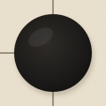</a> 
<a href="https://github.com/aim-qu/aim-qu/issues/new?title=%E7%9F%B3%E3%82%92%E8%BF%94%E3%81%99%E3%80%80A4&body=%E3%81%93%E3%81%AE%E3%81%BE%E3%81%BE%E9%80%81%E4%BF%A1%E3%81%99%E3%82%8B%E3%81%A8%E3%80%81A4%E3%81%AE%E7%9F%B3%E3%81%A8%E3%81%9D%E3%81%AE%E4%B8%8A%E4%B8%8B%E5%B7%A6%E5%8F%B3%E3%81%AE%E7%9F%B3%E3%81%8C%E8%BF%94%E3%82%8A%E3%81%BE%E3%81%99%E3%80%82%0A%E4%B8%80%E5%88%86%E3%81%BB%E3%81%A9%E3%81%A7README%E3%81%AE%E7%9B%A4%E3%81%8C%E6%9B%B8%E3%81%8D%E6%8F%9B%E3%82%8F%E3%82%8A%E3%80%81%E3%81%93%E3%81%AEissue%E3%81%AF%E8%87%AA%E5%8B%95%E3%81%A7%E9%96%89%E3%81%98%E3%81%BE%E3%81%99%E3%80%82">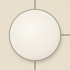</a> <a href="https://github.com/aim-qu/aim-qu/issues/new?title=%E7%9F%B3%E3%82%92%E8%BF%94%E3%81%99%E3%80%80B4&body=%E3%81%93%E3%81%AE%E3%81%BE%E3%81%BE%E9%80%81%E4%BF%A1%E3%81%99%E3%82%8B%E3%81%A8%E3%80%81B4%E3%81%AE%E7%9F%B3%E3%81%A8%E3%81%9D%E3%81%AE%E4%B8%8A%E4%B8%8B%E5%B7%A6%E5%8F%B3%E3%81%AE%E7%9F%B3%E3%81%8C%E8%BF%94%E3%82%8A%E3%81%BE%E3%81%99%E3%80%82%0A%E4%B8%80%E5%88%86%E3%81%BB%E3%81%A9%E3%81%A7README%E3%81%AE%E7%9B%A4%E3%81%8C%E6%9B%B8%E3%81%8D%E6%8F%9B%E3%82%8F%E3%82%8A%E3%80%81%E3%81%93%E3%81%AEissue%E3%81%AF%E8%87%AA%E5%8B%95%E3%81%A7%E9%96%89%E3%81%98%E3%81%BE%E3%81%99%E3%80%82"></a> <a href="https://github.com/aim-qu/aim-qu/issues/new?title=%E7%9F%B3%E3%82%92%E8%BF%94%E3%81%99%E3%80%80C4&body=%E3%81%93%E3%81%AE%E3%81%BE%E3%81%BE%E9%80%81%E4%BF%A1%E3%81%99%E3%82%8B%E3%81%A8%E3%80%81C4%E3%81%AE%E7%9F%B3%E3%81%A8%E3%81%9D%E3%81%AE%E4%B8%8A%E4%B8%8B%E5%B7%A6%E5%8F%B3%E3%81%AE%E7%9F%B3%E3%81%8C%E8%BF%94%E3%82%8A%E3%81%BE%E3%81%99%E3%80%82%0A%E4%B8%80%E5%88%86%E3%81%BB%E3%81%A9%E3%81%A7README%E3%81%AE%E7%9B%A4%E3%81%8C%E6%9B%B8%E3%81%8D%E6%8F%9B%E3%82%8F%E3%82%8A%E3%80%81%E3%81%93%E3%81%AEissue%E3%81%AF%E8%87%AA%E5%8B%95%E3%81%A7%E9%96%89%E3%81%98%E3%81%BE%E3%81%99%E3%80%82"></a> <a href="https://github.com/aim-qu/aim-qu/issues/new?title=%E7%9F%B3%E3%82%92%E8%BF%94%E3%81%99%E3%80%80D4&body=%E3%81%93%E3%81%AE%E3%81%BE%E3%81%BE%E9%80%81%E4%BF%A1%E3%81%99%E3%82%8B%E3%81%A8%E3%80%81D4%E3%81%AE%E7%9F%B3%E3%81%A8%E3%81%9D%E3%81%AE%E4%B8%8A%E4%B8%8B%E5%B7%A6%E5%8F%B3%E3%81%AE%E7%9F%B3%E3%81%8C%E8%BF%94%E3%82%8A%E3%81%BE%E3%81%99%E3%80%82%0A%E4%B8%80%E5%88%86%E3%81%BB%E3%81%A9%E3%81%A7README%E3%81%AE%E7%9B%A4%E3%81%8C%E6%9B%B8%E3%81%8D%E6%8F%9B%E3%82%8F%E3%82%8A%E3%80%81%E3%81%93%E3%81%AEissue%E3%81%AF%E8%87%AA%E5%8B%95%E3%81%A7%E9%96%89%E3%81%98%E3%81%BE%E3%81%99%E3%80%82"></a> <a href="https://github.com/aim-qu/aim-qu/issues/new?title=%E7%9F%B3%E3%82%92%E8%BF%94%E3%81%99%E3%80%80E4&body=%E3%81%93%E3%81%AE%E3%81%BE%E3%81%BE%E9%80%81%E4%BF%A1%E3%81%99%E3%82%8B%E3%81%A8%E3%80%81E4%E3%81%AE%E7%9F%B3%E3%81%A8%E3%81%9D%E3%81%AE%E4%B8%8A%E4%B8%8B%E5%B7%A6%E5%8F%B3%E3%81%AE%E7%9F%B3%E3%81%8C%E8%BF%94%E3%82%8A%E3%81%BE%E3%81%99%E3%80%82%0A%E4%B8%80%E5%88%86%E3%81%BB%E3%81%A9%E3%81%A7README%E3%81%AE%E7%9B%A4%E3%81%8C%E6%9B%B8%E3%81%8D%E6%8F%9B%E3%82%8F%E3%82%8A%E3%80%81%E3%81%93%E3%81%AEissue%E3%81%AF%E8%87%AA%E5%8B%95%E3%81%A7%E9%96%89%E3%81%98%E3%81%BE%E3%81%99%E3%80%82"></a> 
<a href="https://github.com/aim-qu/aim-qu/issues/new?title=%E7%9F%B3%E3%82%92%E8%BF%94%E3%81%99%E3%80%80A5&body=%E3%81%93%E3%81%AE%E3%81%BE%E3%81%BE%E9%80%81%E4%BF%A1%E3%81%99%E3%82%8B%E3%81%A8%E3%80%81A5%E3%81%AE%E7%9F%B3%E3%81%A8%E3%81%9D%E3%81%AE%E4%B8%8A%E4%B8%8B%E5%B7%A6%E5%8F%B3%E3%81%AE%E7%9F%B3%E3%81%8C%E8%BF%94%E3%82%8A%E3%81%BE%E3%81%99%E3%80%82%0A%E4%B8%80%E5%88%86%E3%81%BB%E3%81%A9%E3%81%A7README%E3%81%AE%E7%9B%A4%E3%81%8C%E6%9B%B8%E3%81%8D%E6%8F%9B%E3%82%8F%E3%82%8A%E3%80%81%E3%81%93%E3%81%AEissue%E3%81%AF%E8%87%AA%E5%8B%95%E3%81%A7%E9%96%89%E3%81%98%E3%81%BE%E3%81%99%E3%80%82">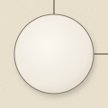</a> <a href="https://github.com/aim-qu/aim-qu/issues/new?title=%E7%9F%B3%E3%82%92%E8%BF%94%E3%81%99%E3%80%80B5&body=%E3%81%93%E3%81%AE%E3%81%BE%E3%81%BE%E9%80%81%E4%BF%A1%E3%81%99%E3%82%8B%E3%81%A8%E3%80%81B5%E3%81%AE%E7%9F%B3%E3%81%A8%E3%81%9D%E3%81%AE%E4%B8%8A%E4%B8%8B%E5%B7%A6%E5%8F%B3%E3%81%AE%E7%9F%B3%E3%81%8C%E8%BF%94%E3%82%8A%E3%81%BE%E3%81%99%E3%80%82%0A%E4%B8%80%E5%88%86%E3%81%BB%E3%81%A9%E3%81%A7README%E3%81%AE%E7%9B%A4%E3%81%8C%E6%9B%B8%E3%81%8D%E6%8F%9B%E3%82%8F%E3%82%8A%E3%80%81%E3%81%93%E3%81%AEissue%E3%81%AF%E8%87%AA%E5%8B%95%E3%81%A7%E9%96%89%E3%81%98%E3%81%BE%E3%81%99%E3%80%82">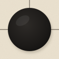</a> <a href="https://github.com/aim-qu/aim-qu/issues/new?title=%E7%9F%B3%E3%82%92%E8%BF%94%E3%81%99%E3%80%80C5&body=%E3%81%93%E3%81%AE%E3%81%BE%E3%81%BE%E9%80%81%E4%BF%A1%E3%81%99%E3%82%8B%E3%81%A8%E3%80%81C5%E3%81%AE%E7%9F%B3%E3%81%A8%E3%81%9D%E3%81%AE%E4%B8%8A%E4%B8%8B%E5%B7%A6%E5%8F%B3%E3%81%AE%E7%9F%B3%E3%81%8C%E8%BF%94%E3%82%8A%E3%81%BE%E3%81%99%E3%80%82%0A%E4%B8%80%E5%88%86%E3%81%BB%E3%81%A9%E3%81%A7README%E3%81%AE%E7%9B%A4%E3%81%8C%E6%9B%B8%E3%81%8D%E6%8F%9B%E3%82%8F%E3%82%8A%E3%80%81%E3%81%93%E3%81%AEissue%E3%81%AF%E8%87%AA%E5%8B%95%E3%81%A7%E9%96%89%E3%81%98%E3%81%BE%E3%81%99%E3%80%82"></a> <a href="https://github.com/aim-qu/aim-qu/issues/new?title=%E7%9F%B3%E3%82%92%E8%BF%94%E3%81%99%E3%80%80D5&body=%E3%81%93%E3%81%AE%E3%81%BE%E3%81%BE%E9%80%81%E4%BF%A1%E3%81%99%E3%82%8B%E3%81%A8%E3%80%81D5%E3%81%AE%E7%9F%B3%E3%81%A8%E3%81%9D%E3%81%AE%E4%B8%8A%E4%B8%8B%E5%B7%A6%E5%8F%B3%E3%81%AE%E7%9F%B3%E3%81%8C%E8%BF%94%E3%82%8A%E3%81%BE%E3%81%99%E3%80%82%0A%E4%B8%80%E5%88%86%E3%81%BB%E3%81%A9%E3%81%A7README%E3%81%AE%E7%9B%A4%E3%81%8C%E6%9B%B8%E3%81%8D%E6%8F%9B%E3%82%8F%E3%82%8A%E3%80%81%E3%81%93%E3%81%AEissue%E3%81%AF%E8%87%AA%E5%8B%95%E3%81%A7%E9%96%89%E3%81%98%E3%81%BE%E3%81%99%E3%80%82"></a> <a href="https://github.com/aim-qu/aim-qu/issues/new?title=%E7%9F%B3%E3%82%92%E8%BF%94%E3%81%99%E3%80%80E5&body=%E3%81%93%E3%81%AE%E3%81%BE%E3%81%BE%E9%80%81%E4%BF%A1%E3%81%99%E3%82%8B%E3%81%A8%E3%80%81E5%E3%81%AE%E7%9F%B3%E3%81%A8%E3%81%9D%E3%81%AE%E4%B8%8A%E4%B8%8B%E5%B7%A6%E5%8F%B3%E3%81%AE%E7%9F%B3%E3%81%8C%E8%BF%94%E3%82%8A%E3%81%BE%E3%81%99%E3%80%82%0A%E4%B8%80%E5%88%86%E3%81%BB%E3%81%A9%E3%81%A7README%E3%81%AE%E7%9B%A4%E3%81%8C%E6%9B%B8%E3%81%8D%E6%8F%9B%E3%82%8F%E3%82%8A%E3%80%81%E3%81%93%E3%81%AEissue%E3%81%AF%E8%87%AA%E5%8B%95%E3%81%A7%E9%96%89%E3%81%98%E3%81%BE%E3%81%99%E3%80%82">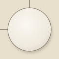</a>

石を押すと、その石と上下左右の石が返ります。すべて白にそろえると一局おわり。いま第1局、黒が13個。

棋譜

- まだ一手も打たれていません

<!-- /live:go -->

<a href="https://aim-qu.github.io/aim-qu/">遊び場をひらく</a>　Rain Beatなど、手で触れる小さな画面があります

AIモデルの順位（2026年10月28日に保存）

Intelligence Index v5.0、公式の初期表示（28モデル）。保存した時点の画像で、自動では更新していません。出典：[Artificial Analysis](https://artificialanalysis.ai/#artificial-analysis-intelligence-index-chart)

星の位置は[HYG Database v4.1](https://github.com/astronexus/HYG-Database)（CC BY-SA 4.0）、天気は[Weather data by Open-Meteo.com](https://open-meteo.com/)（CC BY 4.0）、字形は[Noto Serif JP](./data/OFL-NotoSerifJP.txt)（SIL Open Font License 1.1）、七十二候は略本暦によります。空と障子の絵は一時間ごとにGitHub Actionsで描き直しています。

      
